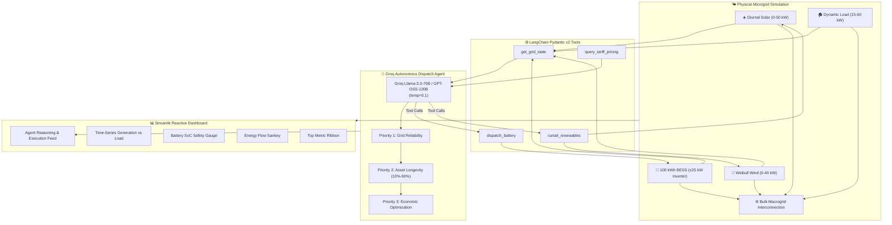

<div align="center">

# ⚡ EcoMesh
### Autonomous Microgrid Energy Management & Dispatch System

[](https://ecomesh-grid.streamlit.app/)
[](https://python.org)
[](https://groq.com)
[](https://langchain.com)
[](https://plotly.com)
[](https://opensource.org/licenses/MIT)

**Sub-second cyber-physical microgrid balancing, dynamic BESS dispatch, and real-time interactive telemetry powered by Groq ultra-low latency LLMs and LangChain tool bindings.**

---

### 🌐 [**Launch Live Interactive Dashboard**](https://ecomesh-grid.streamlit.app/)

</div>

---

## 📖 Table of Contents
- [Executive Overview](#-executive-overview)
- [Key Features](#-key-features)
- [Cyber-Physical Architecture](#-cyber-physical-architecture)
- [Microgrid Physics & Mathematical Model](#-microgrid-physics--mathematical-model)
- [Autonomous Groq Agent Operational Logic](#-autonomous-groq-agent-operational-logic)
- [LangChain Tool Suite](#-langchain-tool-suite)
- [Telemetry & Operator Surface](#-telemetry--operator-surface)
- [Repository Structure](#-repository-structure)
- [Local Installation & Setup](#-local-installation--setup)
- [Streamlit Cloud Deployment](#-streamlit-cloud-deployment)
- [Automated Verification Suite](#-automated-verification-suite)
- [License](#-license)

---

## ⚡ Executive Overview

**EcoMesh** is an autonomous microgrid optimization and telemetry platform designed to balance distributed renewable generation, stochastic consumer demand, and Battery Energy Storage Systems (BESS). 

By uniting a deterministic physical simulation engine with autonomous LLM reasoning via **Groq** high-throughput foundation models (`openai/gpt-oss-120b`, `llama-3.3-70b-versatile`), EcoMesh achieves rapid, structured dispatch decisions to maximize carbon-neutral operational uptime, guarantee grid reliability, and optimize economic yield.

---

## ✨ Key Features

- **Autonomous Agentic Dispatch**: LLM-driven decision cycle that queries microgrid state, analyzes Time-of-Use (ToU) tariffs, and executes explicit tool calls (`dispatch_battery`, `curtail_renewables`).
- **Deterministic Physics Engine**: Rigorous simulation of battery chemical headroom, symmetric round-trip conversion efficiencies ($\eta = 0.94$), diurnal solar curves, Weibull wind distributions, and dual-peak consumer demand.
- **Strict Safety Envelope**: Inverter limits ($\pm 25\text{ kW}$) and hard State-of-Charge (SoC) guards ($10\% \le \text{SoC} \le 90\%$) enforced at both the tool schema level and the physics layer.
- **Dynamic Energy Flow Sankey Diagrams**: Real-time Plotly apportionment diagrams tracking power from generation sources through the central distribution bus to consumers, battery storage, and bulk utility grid.
- **Multi-Model Auto-Discovery**: Automatically queries Groq to detect available high-throughput models on your account (120B / 70B / 20B) with smooth heuristic fallback if offline.
- **Manual Stressor Console**: Sidebar controls to force environmental anomalies (cloud cover solar attenuation, wind calms) or initiate manual human overrides.

---

## 🏛 Cyber-Physical Architecture



---

## 📐 Microgrid Physics & Mathematical Model

The microgrid physical engine enforces real-world physical and electrical laws:

| Parameter | Specification | Physical Role |
| :--- | :--- | :--- |
| **Battery Capacity ($C_{\text{max}}$)** | $100.0\text{ kWh}$ | Total chemical energy storage rating |
| **Inverter Power Limit ($P_{\text{limit}}$)** | $\pm 25.0\text{ kW}$ | Symmetric maximum continuous charge/discharge rating |
| **Round-Trip Efficiency ($\eta$)** | $0.94$ | Applied symmetrically as $\sqrt{\eta} \approx 0.9695$ |
| **Safe SoC Envelope** | $10.0\% - 90.0\%$ | Enforced to prevent cell degradation and thermal runaway |
| **Solar Generation** | $0 - 50.0\text{ kW}$ | Diurnal sine curve with cloud cover attenuation |
| **Wind Generation** | $0 - 40.0\text{ kW}$ | Weibull-distributed velocity profile with calm-drop damping |
| **Consumer Demand** | $15.0 - 60.0\text{ kW}$ | Dual-peak human activity profile with stochastic jitter |

### Mathematical Formulations

1. **Net Power Imbalance ($P_{\text{net}}$)**:
   $$P_{\text{net}} = (P_{\text{solar}} + P_{\text{wind}}) \cdot (1 - \text{curtailment}) - P_{\text{load}}$$

2. **Battery Charging State of Charge Update**:
   $$\Delta \text{SoC}_{\text{charge}} = \frac{P_{\text{batt\_charge}} \cdot \sqrt{\eta} \cdot \Delta t}{C_{\text{max}}} \times 100\%$$

3. **Battery Discharging State of Charge Update**:
   $$\Delta \text{SoC}_{\text{discharge}} = \frac{P_{\text{batt\_discharge}}}{\sqrt{\eta} \cdot C_{\text{max}}} \cdot \Delta t \times 100\%$$

4. **Macrogrid Exchange**:
   $$P_{\text{residual}} = P_{\text{effective\_gen}} - P_{\text{load}} - P_{\text{batt}}$$
   - If $P_{\text{residual}} > 0 \implies \text{Exporting power to macrogrid}$
   - If $P_{\text{residual}} < 0 \implies \text{Importing power from macrogrid}$

---

## 🎯 Autonomous Groq Agent Operational Logic

The agent enforces three non-negotiable operational priorities:

```
  [1. Grid Reliability]
       └── Guarantee consumer load is covered; prevent microgrid collapse.
  [2. Asset Longevity]
       └── Enforce 10% <= SoC <= 90% and prevent micro-cycling.
  [3. Economic Yield]
       ├── Surplus + Peak Tariff: Export to grid for maximum revenue.
       ├── Surplus + Off/Mid-Peak: Charge BESS with clean renewable energy.
       └── Deficit + Peak Tariff: Discharge BESS to avoid expensive grid import.
```

---

## 🛠 LangChain Tool Suite

Every action executed by the LLM is bound via Pydantic v2 schemas:

1. **`get_grid_state`**: Retrieves instantaneous solar, wind, load, SoC, net balance, and active spot tariffs.
2. **`dispatch_battery`**: Commands BESS charging/discharging with automatic clamping to $\pm 25\text{ kW}$ and dynamic verification against current SoC headroom.
3. **`curtail_renewables`**: Sheds generation ($0.0 - 1.0$) during thermal grid congestion or negative pricing.
4. **`query_tariff_pricing`**: Inspects Time-of-Use tariffs across Off-Peak ($\$0.08/\text{kWh}$), Mid-Peak ($\$0.16/\text{kWh}$), and Peak ($\$0.38/\text{kWh}$) windows.

---

## 🖥 Telemetry & Operator Surface

The dashboard delivers an intuitive, high-tech command center:

- **Top Metric Ribbon**: Real-time KPI cards displaying Total Renewable Generation, Consumer Demand, Battery SoC, and Macrogrid Exchange status.
- **Dynamic Generation vs. Load**: Multi-trace Plotly time-series tracking solar, wind, demand, and net imbalance.
- **Battery SoC Safety Gauge**: Tri-zone indicator:
  - 🔴 **$<10\%$**: Danger / Cell Degradation Zone
  - 🟢 **$10\% - 90\%$**: Optimal Operating Envelope
  - 🟠 **$>90\%$**: Saturation / Overcharge Protection
- **Energy Flow Sankey Diagram**: Interactive visual routing from Generation & Grid $\to$ Distribution Bus $\to$ Demand, Battery & Export.
- **Agent Reasoning Feed**: Expandable audit logs displaying the LLM's chain-of-thought, parameter bindings, and execution confirmations.

---

## 📂 Repository Structure

```
EchoMess/
├── .env.example              # Template environment variables
├── .gitignore                # Security filter preventing secret leaks
├── README.md                 # Project documentation & operational guide
├── requirements.txt          # Exact pinned dependencies
├── app.py                    # Streamlit telemetry console & operator UI
├── spec.md                   # Formal engineering specifications
├── engine/
│   ├── __init__.py
│   └── microgrid.py          # Deterministic physical simulation engine
├── tools/
│   ├── __init__.py
│   └── grid_tools.py         # Pydantic v2 LangChain tools
├── agents/
│   ├── __init__.py
│   └── dispatch_agent.py     # Groq dispatch agent with model auto-discovery
└── tests/
    └── test_ecomesh.py       # Automated physical constraints test suite
```

---

## 💻 Local Installation & Setup

### 1. Clone Repository

```bash
git clone https://github.com/Arvindkumar-star/EchoMess.git
cd EchoMess
```

### 2. Set Up Virtual Environment

```bash
# Windows
python -m venv .venv
.venv\Scripts\activate

# macOS / Linux
python3 -m venv .venv
source .venv/bin/activate
```

### 3. Install Requirements

```bash
pip install -r requirements.txt
```

### 4. Configure Environment

Create your `.env` file from the example template:

```bash
cp .env.example .env
```

Add your [Groq API Key](https://console.groq.com/):
```env
GROQ_API_KEY=gsk_your_groq_api_key_here
STREAMLIT_SERVER_PORT=8501
```

### 5. Launch the Dashboard

```bash
streamlit run app.py
```
Open **`http://localhost:8501`** in your browser.

---

## ☁️ Streamlit Cloud Deployment

The live application is hosted on **Streamlit Community Cloud**:

🔗 **Live URL**: [https://ecomesh-grid.streamlit.app/](https://ecomesh-grid.streamlit.app/)

### To deploy your own fork:
1. Fork or push this repository to GitHub.
2. Sign in to [share.streamlit.io](https://share.streamlit.io).
3. Select `Arvindkumar-star/EchoMess`, branch `main`, and main file `app.py`.
4. In **Advanced Settings → Secrets**, add:
   ```toml
   GROQ_API_KEY = "gsk_your_groq_api_key_here"
   ```
5. Click **Deploy!**

---

## 🧪 Automated Verification Suite

Run the test suite to validate physical formulas, boundary clamping, and LangChain tool schemas:

```bash
python tests/test_ecomesh.py
```

Expected output:
```
All unit tests passed successfully!
```

---

## 📄 License

This project is licensed under the **MIT License** — see the [LICENSE](LICENSE) file for details.

---

<div align="center">
<b>EcoMesh</b> — Engineering Autonomous Cyber-Physical Grids for a Resilient Clean Energy Future.
</div>
